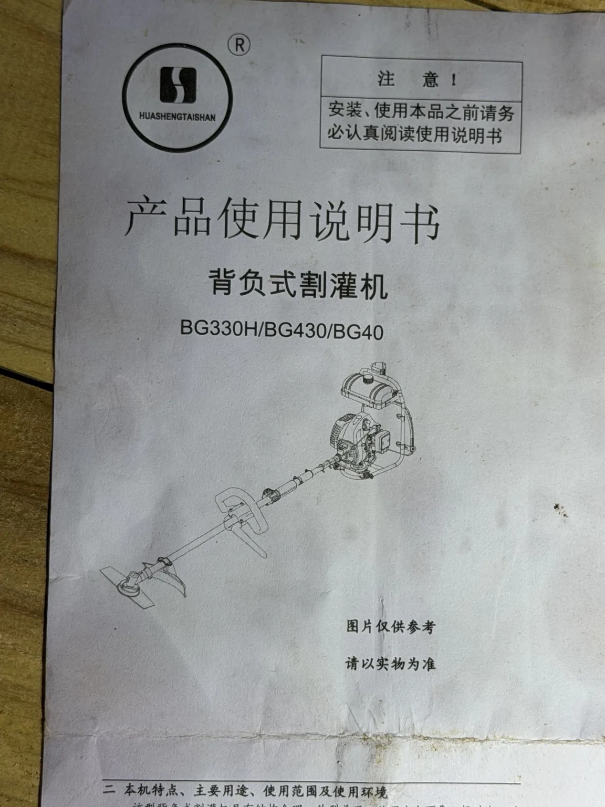
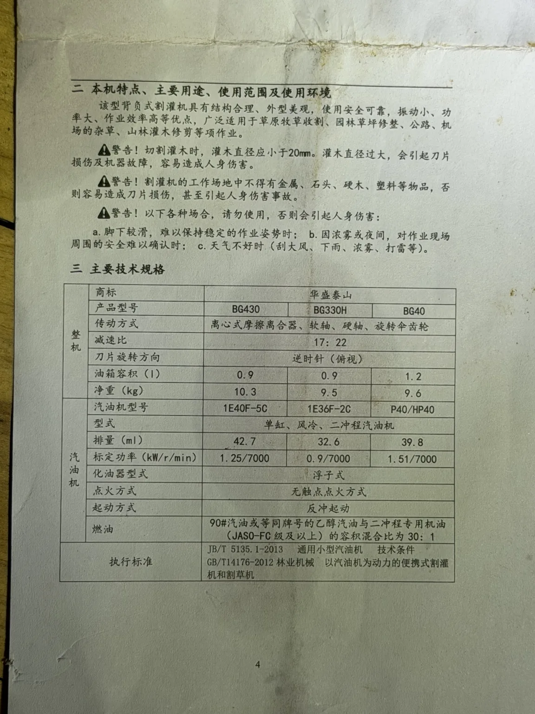
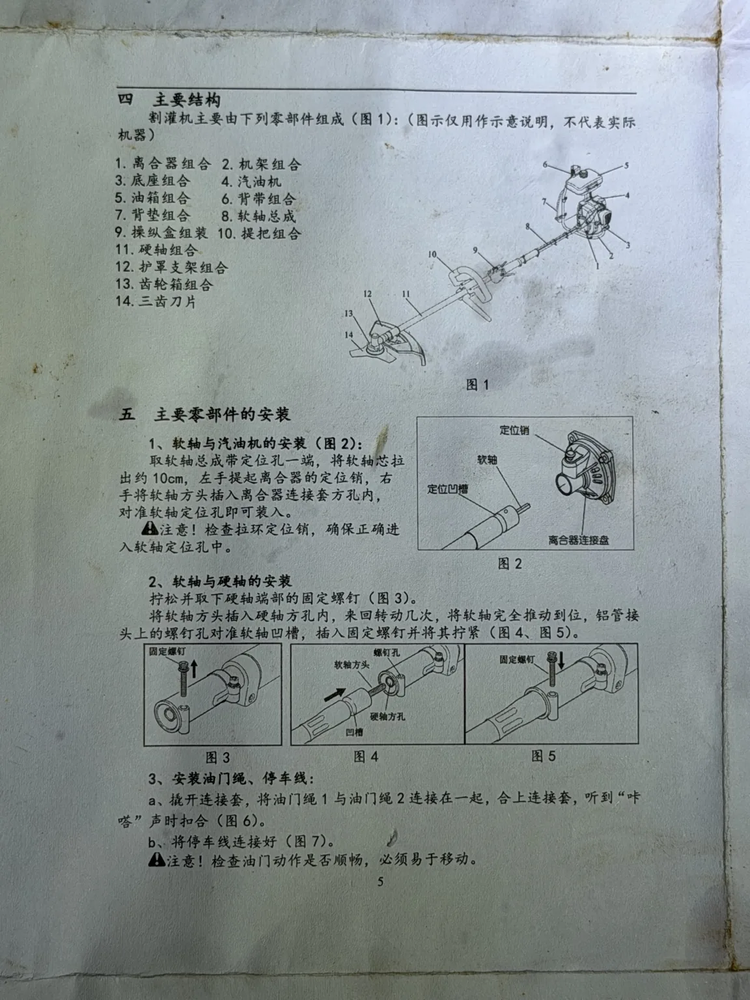
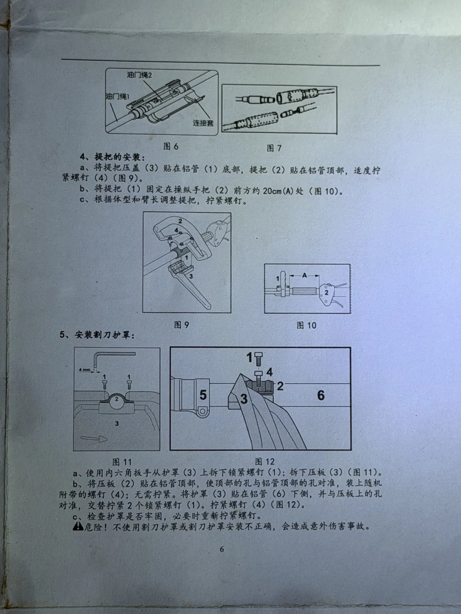
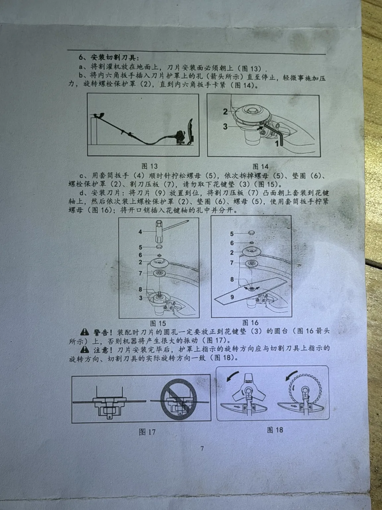
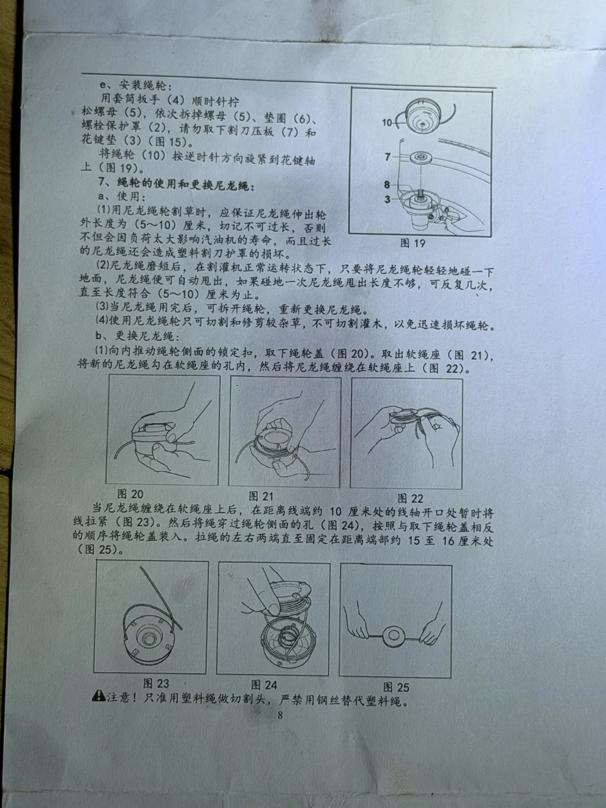
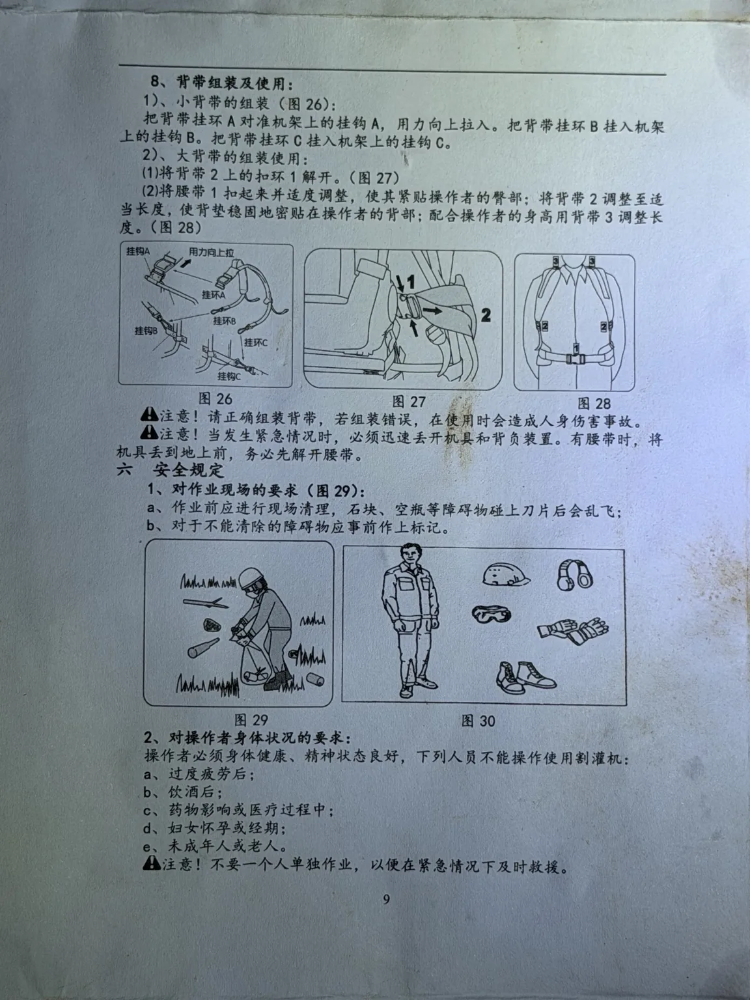
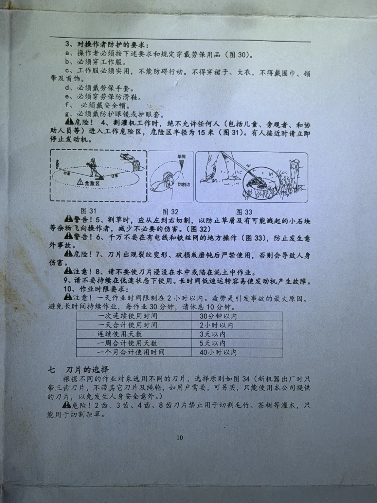
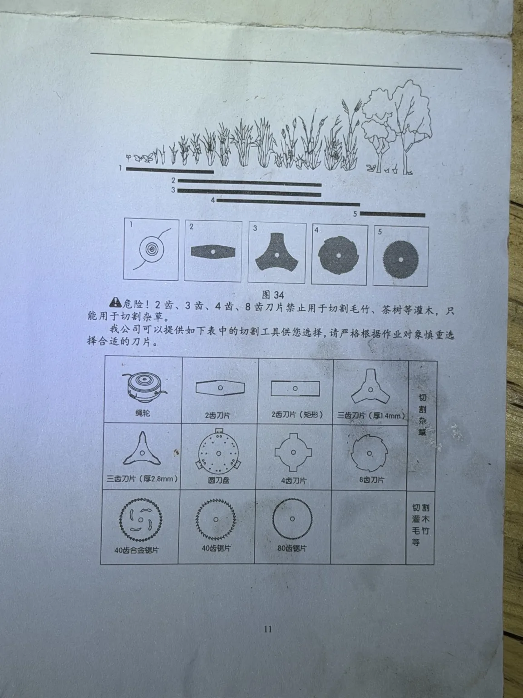
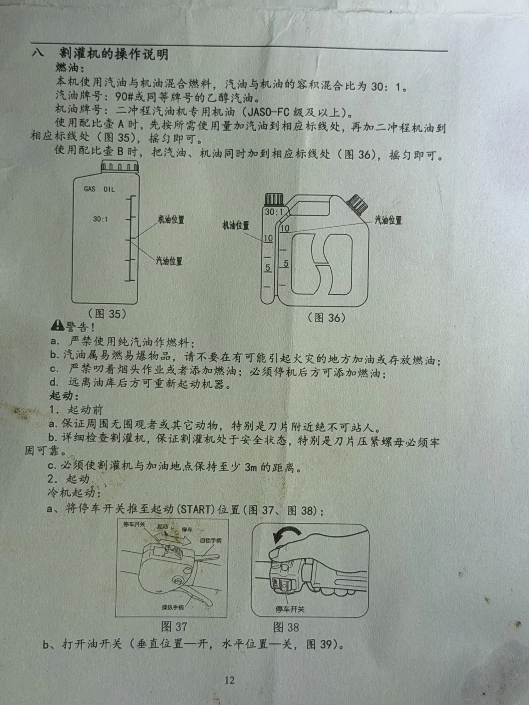

# 华盛泰山 HUASHENGTAISHAN｜背负式割灌机使用说明书

**适用型号：BG330H / BG430 / BG40**
**资料来源：2026-10-17 拍摄的纸本说明书，共 10 张照片**
**保存范围：封面、纸本第 4–12 页；纸本第 1–3 页及第 13 页以后未提供。**

> **归档说明**：本文件以原厂简体中文为主，按纸本页码依序转录；为使 Codex 易于检索，增加了 Markdown 标题、表格和图片连结。图示本身没有改绘，直接参照 `images/` 目录中的原始照片。少量不清晰或原文可能有排印错误的地方，文末另有校对提示。**此文字不能替代核对原始图片，尤其是刀具与发动机的安全事项。**

## 照片、页码对应

| 图片文件 | 纸本内容 |
|---|---|
| [封面原圖](images/huashengtaishan-brush-cutter-manual-cover.webp) | 封面（底缘同时拍到第 4 页开头） |
| [第 4 頁原圖](images/huashengtaishan-brush-cutter-manual-page-04.webp) | 第 4 页 |
| [第 5 頁原圖](images/huashengtaishan-brush-cutter-manual-page-05.webp) | 第 5 页 |
| [第 6 頁原圖](images/huashengtaishan-brush-cutter-manual-page-06.webp) | 第 6 页 |
| [第 7 頁原圖](images/huashengtaishan-brush-cutter-manual-page-07.webp) | 第 7 页 |
| [第 8 頁原圖](images/huashengtaishan-brush-cutter-manual-page-08.webp) | 第 8 页 |
| [第 9 頁原圖](images/huashengtaishan-brush-cutter-manual-page-09.webp) | 第 9 页 |
| [第 10 頁原圖](images/huashengtaishan-brush-cutter-manual-page-10.webp) | 第 10 页 |
| [第 11 頁原圖](images/huashengtaishan-brush-cutter-manual-page-11.webp) | 第 11 页 |
| [第 12 頁原圖](images/huashengtaishan-brush-cutter-manual-page-12.webp) | 第 12 页 |

---

# 【封面】

华盛泰山（HUASHENGTAISHAN）

> 注 意！
> 安装、使用本品之前请务必认真阅读使用说明书

**产品使用说明书**
**背负式割灌机**
**BG330H / BG430 / BG40**

图片仅供参考
请以实物为准

---

# 【纸本第 4 页】

## 二　本机特点、主要用途、使用范围及使用环境

该型背负式割灌机具有结构合理、外型美观、使用安全可靠、振动小、功率大、作业效率高等优点，广泛适用于草原牧草收割、园林草坪修整、公路、机场的杂草、山林灌木修剪等项作业。

⚠ **警告！** 切割灌木时，灌木直径应小于20mm。灌木直径过大，会引起刀片损伤及机器故障，容易造成人身伤害。

⚠ **警告！** 割灌机的工作场地中不得有金属、石头、硬木、塑料等物品，否则容易造成刀片损伤，甚至引起人身伤害事故。

⚠ **警告！** 以下各种场合，请勿使用，否则会引起人身伤害：

a. 脚下较滑，难以保持稳定的作业姿势时；
b. 因浓雾或夜间，对作业现场周围的安全难以确认时；
c. 天气不好时（刮大风、下雨、浓雾、打雷等）。

## 三　主要技术规格

| 项目 | BG430 | BG330H | BG40 |
|---|---:|---:|---:|
| 商标 | 华盛泰山 | 华盛泰山 | 华盛泰山 |
| 传动方式 | 离心式摩擦离合器、软轴、硬轴、旋转伞齿轮 | 同左 | 同左 |
| 减速比 | 17:22（原表共用栏） | 17:22 | 17:22 |
| 刀片旋转方向 | 逆时针（俯视） | 同左 | 同左 |
| 油箱容积（l） | 0.9 | 0.9 | 1.2 |
| 净重（kg） | 10.3 | 9.5 | 9.6 |
| 汽油机型号 | 1E40F-5C | 1E36F-2C | P40/HP40 |
| 汽油机型式 | 单缸、风冷、二冲程汽油机 | 同左 | 同左 |
| 排量（ml） | 42.7 | 32.6 | 39.8 |
| 标定功率（kW/r/min） | 1.25/7000 | 0.9/7000 | 1.51/7000 |
| 化油器型式 | 浮子式 | 同左 | 同左 |
| 点火方式 | 无触点点火方式 | 同左 | 同左 |
| 起动方式 | 反冲起动 | 同左 | 同左 |
| 燃油 | 90#汽油或等同牌号的乙醇汽油与二冲程专用机油（JASO-FC级及以上）的容积混合比为30:1 | 同左 | 同左 |

**执行标准**

- JB/T 5135.1-2013　通用小型汽油机　技术条件
- GB/T14176-2012　林业机械　以汽油机为动力的便携式割灌机和割草机

> 注：表中的“同左”表示原始表格为横跨三个机型的共用单元格；不是原厂另写的字。

---

# 【纸本第 5 页】

## 四　主要结构

割灌机主要由下列零部件组成（图1）：（图示仅用作示意说明，不代表实际机器）

1. 离合器组合
2. 机架组合
3. 底座组合
4. 汽油机
5. 油箱组合
6. 背带组合
7. 背垫组合
8. 软轴总成
9. 操纵盒组装
10. 提把组合
11. 硬轴组合
12. 护罩支架组合
13. 齿轮箱组合
14. 三齿刀片

**图 1：主要结构图。**

## 五　主要零部件的安装

### 1、软轴与汽油机的安装（图2）

取软轴总成带定位孔一端，将软轴芯拉出约10cm，左手提起离合器的定位销，右手将软轴方头插入离合器连接套方孔内，对准软轴定位孔即可装入。

⚠ **注意！** 检查拉环定位销，确保正确进入软轴定位孔中。

**图 2 标示**：软轴、定位凹槽、定位销、离合器连接盘。

### 2、软轴与硬轴的安装

拧松并取下硬轴端部的固定螺钉（图3）。

将软轴方头插入硬轴方孔内，来回转动几次，将软轴完全推到位，铝管接头上的螺钉孔对准软轴凹槽，插入固定螺钉并将其拧紧（图4、图5）。

**图 3–5 标示**：固定螺钉、螺钉孔、软轴方头、硬轴方孔、凹槽。

### 3、安装油门绳、停车线

a. 掀开连接套，将油门绳1与油门绳2连接在一起，合上连接套，听到“咔嗒”声时扣合（图6）。

b. 将停车线连接好（图7）。

⚠ **注意！** 检查油门动作是否顺畅，必须易于移动。

**图 6–7**：油门绳、连接套和停车线接头。

---

# 【纸本第 6 页】

## 五　主要零部件的安装（续）

### 4、提把的安装

a. 将提把压盖（3）贴在铝管（1）底部，提把（2）贴在铝管顶部，适度拧紧螺钉（4）（图9）。

b. 将提把（1）固定在操纵手把（2）前方约20cm（A）处（图10）。

c. 根据体型和臂长调整提把，拧紧螺钉。

**图 9–10**：提把固定方式及与操纵手把间距约20cm。

### 5、安装割刀护罩

a. 使用内六角扳手从护罩（3）上拆下锁紧螺钉（1）；拆下压板（3）（图11）。

b. 将压板（2）贴在铝管顶部，使顶部的孔与铝管顶部的孔对准，装上随机附带的螺钉（4）；无需拧紧。将护罩（3）贴在铝管（6）下侧，并与压板上的孔对准，交替拧紧2个锁紧螺钉（1）。拧紧螺钉（4）（图12）。

c. 检查护罩是否牢固，必要时重新拧紧螺钉。

⚠ **危险！** 不使用割刀护罩或割刀护罩安装不正确，会造成意外伤害事故。

**图 11–12**：护罩、压板、铝管与螺钉的安装顺序。

> 校对提示：第 5 项 a 段原纸本「护罩（3）」「压板（3）」数字看似重复，属于原文可能有编号不一致之处；实际安装请依图片及实体零件核对，勿仅依文字装配。

---

# 【纸本第 7 页】

## 五　主要零部件的安装（续）

### 6、安装切割刀具

a. 将割灌机放在地面上，刀片安装面必须朝上（图13）。

b. 将内六角扳手插入刀片护罩上的孔（箭头所示）直至停止，轻微施加压力，旋转螺栓保护罩（2），直到内六角扳手卡紧（图14）。

c. 用套筒扳手（4）顺时针拧松螺母（5），依次拆掉螺母（5）、垫圈（6）、螺栓保护罩（2）、割刀压板（7），请勿取下花键垫（3）（图15）。

d. 安装刀片：将刀片（9）放置到位，将割刀压板（7）凸面朝上套装到花键轴上，然后依次装上螺栓保护罩（2）、垫圈（6）、螺母（5），使用套筒扳手拧紧螺母（图16）；将开口销插入花键轴的孔中并分开。

⚠ **警告！** 装配时刀片的圆孔一定要放正到花键垫（3）的圆台（图16箭头所示）上，否则机器将产生很大的振动（图17）。

⚠ **注意！** 刀片安装完毕后，护罩上指示的旋转方向应与切割刀具上指示的旋转方向、切割刀具的实际旋转方向一致（图18）。

**图 13–18**：装机朝向、拆装螺母、刀片安装、正确的刀片中心定位与旋转方向。

---

# 【纸本第 8 页】

## 五　主要零部件的安装（续）

### e、安装绳轮

用套筒扳手（4）顺时针拧松螺母（5），依次拆掉螺母（5）、垫圈（6）、螺栓保护罩（2），请勿取下割刀压板（7）和花键垫（3）（图15）。

将绳轮（10）按逆时针方向旋紧到花键轴上（图19）。

### 7、绳轮的使用和更换尼龙绳

#### a、使用

（1）用尼龙绳轮割草时，应保证尼龙绳伸出轮外长度为（5～10）厘米，切记不可过长，否则不但会因负荷太大影响汽油机的寿命，而且过长的尼龙绳还会造成塑料割刀护罩的损坏。

（2）尼龙绳磨短后，在割灌机正常运转状态下，只要将尼龙绳轮轻轻地碰一下地面，尼龙绳便可自动甩出，如果碰地一次尼龙绳甩出长度不够，可反复几次，直至长度符合（5～10）厘米为止。

（3）当尼龙绳用完后，可拆开绳轮，重新更换尼龙绳。

（4）使用尼龙绳轮只可切割和修剪较杂草，不可切割灌木，以免迅速损坏绳轮。

#### b、更换尼龙绳

（1）向内推动绳轮侧面的锁定扣，取下绳轮盖（图20）。取出软绳座（图21），将新的尼龙绳分在软绳座的孔内，然后将尼龙绳缠绕在软绳座上（图22）。

当尼龙绳缠绕在软绳座上后，在距离线端约10厘米处的线轴开口处暂时将线拉紧（图23）。然后将绳穿过绳轮侧面的孔（图24），按照与取下绳轮盖相反的顺序将绳轮盖装入。拉绳的左右两端直至固定在距离端部约15至16厘米处（图25）。

⚠ **注意！** 只许用塑料绳做切割头，严禁用钢丝替代塑料绳。

**图 19–25**：绳轮拆装、开盖、绕线、出线、拉紧的动作。

> 校对提示：纸本第 8 页更换尼龙绳段有些字词印刷或阅读不清，例如「软绳座」与「将新的尼龙绳分在」；疑似排印或语词问题，实作请查看原照片图20–25。

---

# 【纸本第 9 页】

## 五　主要零部件的安装（续）

### 8、背带组装及使用

#### 1）、小背带的组装（图26）

把背带挂环A对准机架上的挂钩A，用力向上拉入。把背带挂环B插入机架上的挂钩B。把背带挂环C插入机架上的挂钩C。

#### 2）、大背带的组装使用

（1）将背带2上的扣环1解开。（图27）

（2）将腰带1扣起来并适度调整，使其紧贴操作者的臀部；将背带2调整至适当长度，使背垫稳固地密贴在操作者的背部；配合操作者的身高用背带3调整长度。（图28）

⚠ **注意！** 请正确组装背带，若组装错误，在使用时会造成人身伤害事故。

⚠ **注意！** 当发生紧急情况时，必须迅速丢开机具和背负装置。有腰带时，将机具丢到地上前，务必先解开腰带。

## 六　安全规定

### 1、对作业现场的要求（图29）

a. 作业前应进行现场清理，石块、空瓶等障碍物碰上刀片后会乱飞；

b. 对于不能清除的障碍物应事前作上标记。

### 2、对操作者身体状况的要求

操作者必须身体健康、精神状态良好，下列人员不能操作使用割灌机：

a. 过度疲劳后；

b. 饮酒后；

c. 药物影响或医疗过程中；

d. 妇女怀孕或经期；

e. 未成年人或老人。

⚠ **注意！** 不要一个人单独作业，以便在紧急情况下及时救援。

---

# 【纸本第 10 页】

## 六　安全规定（续）

### 3、对操作者防护的要求

a. 操作者必须按下述要求和规定穿戴劳保用品（图30）。

b. 必须穿工作服。

c. 工作服必须实用，不能妨碍行动。不得穿裙子、大衣，不得戴围巾、领带及首饰。

d. 必须戴劳保手套。

e. 必须穿劳保防滑鞋。

f. 必须戴安全帽。

g. 必须戴防护眼镜或护眼套。

⚠ **危险！ 4、** 割灌机工作时，绝不允许任何人（包括儿童、旁观者、和协助人员等）进入工作危险区，危险区半径为15米（图31）。有人接近时请立即停止发动机。

⚠ **警告！ 5、** 割草时，应从左到右切割，以防止草屑及有可能激起的小石块等杂物飞向操作者，减少不必要的伤害。（图32）

⚠ **警告！ 6、** 千万不要在有电线和铁丝网的地方操作（图33），防止发生意外事故。

⚠ **危险！ 7、** 刀片出现裂纹变形、破损或磨钝后严禁使用，否则会导致人身伤害。

⚠ **注意！ 8、** 请不要使刀片浸没在水中或陷在泥土中作业。

**9、** 请不要持续在低速状态下使用。长时间低速运转容易使发动机产生故障。

### 10、作业时限要求

⚠ 注意！一天作业时间限制在2小时以内。疲劳是引发事故的最大原因。避免长时间持续作业，每作业30分钟，请休息10分钟。

| 项目 | 限制 |
|---|---|
| 一次连续使用时间 | 30分钟以内 |
| 一天合计使用时间 | 2小时以内 |
| 连续使用天数 | 3天以内 |
| 一周合计使用天数 | 5天以内 |
| 一个月合计使用时间 | 40小时以内 |

## 七　刀片的选择

根据不同的作业对象选用不同的刀片，选择原则如图34（新机器出厂时只带三齿刀片，不带其它刀片及绳轮，如用户需要，可另买，只能使用本公司提供的刀片，以免发生人身安全意外。）

⚠ **危险！** 2齿、3齿、4齿、8齿刀片禁止用于切割毛竹、茶树等灌木，只能用于切割杂草。

---

# 【纸本第 11 页】

## 七　刀片的选择（续；图34）

图34上部以草本植物到树木的示意及横向条带，说明从尼龙绳轮到锯片可处理的植被范围。原图建议的 5 类切割工具示意为：

1. 绳轮
2. 双齿刀片
3. 三齿刀片
4. 圆盘类多齿刀片
5. 锯片类刀片

**刀具图解表（按原图列序）**

| 切割杂草（前两排） | | | |
|---|---|---|---|
| 绳轮 | 2齿刀片 | 2齿刀片（矩形） | 三齿刀片（厚1.4mm） |
| 三齿刀片（厚2.8mm） | 圆刀盘 | 4齿刀片 | 8齿刀片 |

| 切割灌木、毛竹等（第三排） | | |
|---|---|---|
| 40齿合金锯片 | 40齿锯片 | 80齿锯片 |

⚠ **危险！** 2齿、3齿、4齿、8齿刀片禁止用于切割毛竹、茶树等灌木，只能用于切割杂草。

该公司可以提供如下表中的切割工具供您选择，请严格根据作业对象慎重选择合适的刀片。

> 本页以图片为主要信息；刀片形状、粗细及图34的植被适用范围务必以 `images/huashengtaishan-brush-cutter-manual-page-11.webp` 原图为准，文字表格仅为图中名称的索引。

---

# 【纸本第 12 页】

## 八　割灌机的操作说明

### 燃油

本机使用汽油与机油混合燃料，汽油与机油的容积混合比为 **30:1**。

汽油牌号：90#或同等牌号的乙醇汽油。

机油牌号：二冲程汽油机专用机油（JASO-FC级及以上）。

使用配比壶A时，先按所需使用量加汽油到相应标线处，再加二冲程机油到相应标线处（图35），摇匀即可。

使用配比壶B时，把汽油、机油同时加到相应标线处（图36），摇匀即可。

⚠ **警告！**

a. 严禁使用纯汽油作燃料；

b. 汽油属易燃易爆物品，请不要在有可能引起火灾的地方加油或存放燃油；

c. 严禁叼着烟头作业或者添加燃油；必须停机后方可添加燃油；

d. 远离油库后方可重新起动机器。

### 起动

#### 1、起动前

a. 保证周围无围观者或者其它动物，特别是刀片附近绝不可站人。

b. 详细检查割灌机，保证割灌机处于安全状态，特别是刀片压紧螺母必须牢固可靠。

c. 必须使割灌机与加油地点保持至少3m的距离。

#### 2、起动

**冷机起动：**

a. 将停车开关推至起动（START）位置（图37、图38）。

b. 打开油开关（垂直位置—开，水平位置—关，图39）。

**本次照片在这里结束。** 后续冷机起动操作、热机起动、停机、维护与故障排除（如果原说明书有这些章节）尚未提供；请勿自行推定完整步骤。

---

# 归档校对与安全备注（非原厂文字）

1. 当前只有**封面 + 原书第 4–12 页**，不构成整本手册；第 1–3 页和第 13 页以后缺失。
2. 「BG330H / BG430 / BG40」是**同册涵盖的型号**，还不能确定 Joyforest 实际买到的是其中哪一型，需核对机器铭牌、发动机或卖场订单。
3. 第 4 页规格数据和第 12 页燃油比例均写为**汽油：二冲程机油 = 30：1**（容积比）。换算示例：汽油 1,000 mL + 二冲程机油约 33.3 mL（不要将总混合油量 1,000 mL 与 1,000 mL 汽油混淆）。
4. 安全重点：作业危险区半径 15 米、加油点与起动点至少 3 米、绝不使用纯汽油、不得以钢丝代替尼龙绳、刀片圆孔必须正确定位、必须安装护罩；每连续使用 30 分钟建议休息 10 分钟。
5. 文档为人工阅读照片后转录，部分连接件名称、编号与原书的印刷词句可能有歧义；保留原始图片可用于再校对。
6. 机器的具体保养周期、化油器调整及起动完整流程尚无相应原书照片，不能据此文件猜测。
